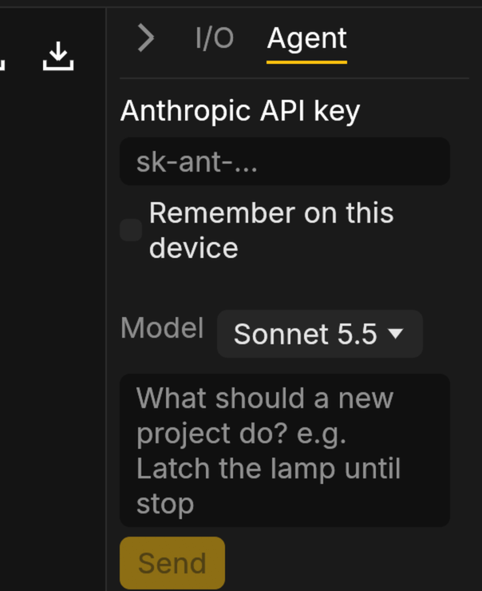
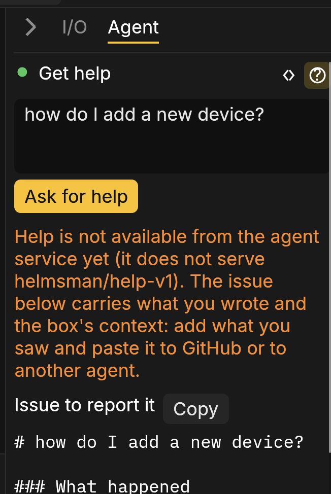

# Describing a change

Describing is the way you program: say what the machine should do. The page
opens on the **Describe** tab, the first in the left pane: type what the open
Structured Text file should do, and press
**Send**, the yellow paper plane (or <kbd>Enter</kbd>). The file is updated in place and the editor shows it; there is
no conversation to read through.

The lower half of the tab is the answer. While it works it shows one
line, how long the instruction has been running and the range it takes
for a file of that size, from the least to the usual most (5 to 30
seconds for a short file, a few minutes for a long one). The time
includes any second try, so it is the whole wait. The Code tab shows the
draft in place of the file as it is written. The file itself changes
only once the draft compiles and its checks pass; Stop, or a draft that
fails, leaves it as it was.

A change too big for one answer goes in steps. A long instruction, one
in several parts or one on a long file is planned first, and so is any
change whose answer ran out of room. The tab lists the steps in plain
words and starts on the first at once; Stop drops them and leaves the
file as it was. Each step is checked like any answer, on a copy, and
builds on the steps before it. The file changes once, when every step
has passed, as one version in History. A step that fails its checks
pauses the plan with what went wrong: Try this step again, or Stop to
leave the file as it was.

An instruction can be a new behaviour ("the lamp latches until stop is
pressed"), a change ("add a two-second delay before the belt starts") or
a fix for the errors under the editor. When it is done, the answer is
one short line, for example:

> Done: the lamp now latches until stop is pressed.

When nothing could be changed, the answer says why in red, with the
first lines of what failed; **Details in the Log** opens the
Log, which keeps all of it: hold the pointer over a line there for
the whole text.

## Help with the words

A request that names the program's inputs and outputs and says when is
understood first time. When what you type names an input
or output another way ("green lamp" for `GreenLamp`, or `StratPB` for
`StartPB`), the area says so with a button that puts the declared name
in. None of this is sent anywhere.

On a box nothing runs until you deploy it, as with any edit of your own.
In the simulation the changed program runs at once.

The instruction box is at the top of the tab, one row tall. It grows as
you type, to ten rows, and scrolls inside after that. Under it are the
buttons, and under those the answer, down to the bottom of the tab. A
click anywhere on the answer puts the cursor back in the box. The
answer's text can be selected and copied.

When Helmsman has a question about what you asked, it appears as a
card in the accent colour between the buttons and the answer, with a
button for each reply.

What the change did is marked until your next edit. In the code, lines
it added are on a green ground and a red rule stands where it removed
lines (point at the rule to read them). On the diagram, blocks and wires
it added are outlined green and those it removed are drawn as faint red
ghosts where they were. In the simulation the diagram shows the change
at once; on a box the diagram is what runs, so its marks appear when you
deploy.

## Checked before it is written

With every change Helmsman writes one or more scenarios: short
requirement tests, each stating in plain words what it checks, such as
"the lamp stays off while start is not pressed". Before anything is
written, the change is taken into a copy of the project, compiled, and
the scenarios run together with the project's own requirement tests.

If anything fails (a scenario, a requirement test, the compile, or the
whole-file rule below), Helmsman is sent what failed and fixes the
answer, up to two more tries. An answer that still fails is never
written: the file stays as it was and the tab says why, one line per
failure. A change that comes without a scenario is asked for one once;
if none comes, it is written and the status line says no scenario checks
it. When Helmsman answers without code (it needs one fact from you, or
what was asked cannot be done as written), the tab shows its words and
the file is not touched.

**The nearest thing, on a button.** An instruction that cannot be done
as written comes back with one line on what stands in the way and, under
it, up to two buttons for the closest things that can be done:

- **Rename a to b** renames an input, an output or a variable in every
  file of the project, the wiring and the requirement tests with the
  program. The files it changes are listed under the button. It is saved
  as one revision with its own History entry, and Undo takes it back.
  Asking for a rename in words ("call lamp beacon") gives the same
  button.
- **Another instruction** in the program's own names. One click sends it
  as yours, and it is checked like any other.

**Leave it** takes the buttons away and changes nothing.

The scenarios of a change that is written are kept as requirement tests
and appear in the Requirements tab, each under its own words.

When an instruction changes behaviour that an existing requirement test
checks ("the motor runs only while start is held" against a test that
says it latches), Helmsman replaces that test with one stating the new
requirement. The replacement has to pass like any scenario, every other
test still has to, and the status line names it:

> Updated main.st: 1 scenario passed, kept as a test; changed requirement
> test_latch: the motor runs while start is held.

The test as it was stays in History, and Undo puts both back.

## History and Undo

Every change Helmsman writes is saved as one revision in the project's
History (the Files tab), named after the instruction. Its entry holds the
instruction, Helmsman's reason, the scenarios that passed, the answers
that failed and were sent back, and Helmsman's words. Edits of your own
you had not saved are saved first, as their own revision, so the version
before the change is always there.

**Undo**, the arrow hooked back beside Send, puts the file back as it was before the last
change (a new revision; the change stays in History). It is offered while
the file is still as Helmsman left it; after an edit of your own, go
back through History instead.

In the simulation the arrows beside Send take Undo's place: the left
arrow steps back one revision, the right arrow forward one, as far as
the first revision and the newest. Each revision shown runs at once,
marked green and red with what it changed, and its tooltip names the
instruction behind it. Saving keeps the version shown; an edit of your
own puts the arrows away. Each step also puts that version's instruction
back in the box and what came of it in the answer area, and writes
nothing to the Log.

The **i** between the arrows opens the version on show in a window,
the same one the Code tab's **i** opens. It starts with what you asked,
in large type, and a line saying what came of it: whether the checks
passed. Under that are who saved it and when ("3 hours ago" and the
date) and its version number. **What changed** lists each file with the
lines added in green and removed in red, and the changed lines
themselves; a long one starts folded. **Why**, **Requirements it
passed**, **Attempts that did not pass** and **The explanation it gave**
are folded until you open them. A version that was a plain save, an
upload or a restore shows the same window with what it has. **Restore
this version** puts the project's files back as they were then, saved as
a new version; Escape or **Close** leaves the window.

The clock beside the arrows turns the answer area into the list of the
project's versions, newest first, with a box to search what each one
says. A click runs a version, as the arrows do; the clock again brings
the answer back.

## Follow-ups

Each instruction goes to Helmsman with the whole file and the history of
that file, read from History: every change made to it, oldest first, each
with what was asked, why, and how it came out. So "now make it blink
faster" works, Helmsman knows what "it" is even after a reload, and a
decision made weeks ago is still known. In the browser this history is
kept with the project, apart from its versions, so it is still there
after old versions have gone, and it is in the project's download. When
it grows very long, Helmsman writes up the oldest changes once as a short
summary, which takes their place; the newest changes always go word for
word.
To start over, describe the whole behaviour in the instruction.

## What a change may touch

Helmsman edits what you have in focus and nothing else: the file open
in the Code tab, by default. When you select lines in the Code tab or
pick a block in the diagram, a line above the instruction box says so:

- **Editing: lines 12–30 of main.st**: the lines you selected.
- **Editing: block Motor1**: the statement of the block you picked.

**Whole file** next to it drops the selection or the pick. A change to
anything outside the scope (another file, lines outside the selection,
anything beside the block) is refused, and the rest of the project stays
exactly as it was.

The code always comes back as the whole open file with the change made
in it, even for a few selected lines or a block. Nothing may be left
out: an answer that skips part of the file, or writes "rest unchanged"
where code should be, is sent back.

## Design a machine

For a whole machine, describe it and ask for a design before any code.
**Design a machine…** is in the Describe tab. It is
there when the design entry is served: on a box, for an engineer with a
project open; in the simulation, only when the relay says it serves it. When it is closed for now, or this
hour's allowance is used up, the tab says so beside the button, with the
time to wait, and the chat carries on as before.

A window opens with a box for the description: the stations, the sensors
and actuators, what must happen when something goes wrong. If you have a
written scope of work or product documentation, paste it into the second
box or press **Add file…** for `.md` and `.txt` files (up to eight). The
window lists each file with its size and a × to take it out, and shows the
total against the most one request takes (120 KiB in the simulation; a box
takes much more). A file that is empty, is not UTF-8 text, or holds control
characters is refused with the reason and nothing of it is changed; a PDF
is not taken, so paste its text. The
description can be left out when the documents say what the machine is.
Whatever the documents state as a requirement becomes a requirement of the
design. Press **Ask for a design**. A design takes minutes, and the tab shows the time, how much
has been written and the model's own summary of what it is working out as
it streams. **Stop** drops it and nothing is kept. If the stream stops
before the end, the tab says so and offers **Carry on**, which asks for
that turn again, or **Discard**. A large design takes several turns; they
follow each other by themselves. In the simulation the relay takes at most
five turns and 1 MiB in one go: past that the tab says the design is too
large for the playground, and a smaller machine, or one part of it, fits.

The design comes back with a card: how many parts, requirements and build
steps it holds, its one-sentence summary, and anything that stops Helmsman building from it (a step that names a requirement the design does
not have, a requirement no step covers, a section missing). **Read the
design** opens it one section at a time: Machine, Signals, Parts, Faults,
Requirements, Build order and Open questions. When there is a problem,
Build is not offered; ask again with the machine described more closely.

**Keep** puts the design in the project as `design.md`, and the documents
you gave as `documents.md`, as one version in History. With a built-in example open, the simulation makes a project of
its own named for the machine. On a box the file route writes only the
files a project uses, so Keep makes a copy of the open project, as the box
holds it, with `design.md` in it, in one request; save your edits first.
The Describe tab then shows this project's design and **Build steps 1 to 6**.

Build hands the design's build order to Helmsman a few steps at a time.
Each step is asked for with the design's own text: the step, the signal
table, the parts it names and the requirements it must pass, with a check
for each. A requirement a check cannot show in the simulation, such as one
that needs hardware or a person, is kept as an empty test, shown as
untested and never red, and the status says how many. A check that did not
pass is not kept, but its requirement is, in the same way. Anything collected with **Chat about this**
goes with every step of the batch, as it does with an instruction. The
steps run on a copy, each checked like any answer, and the file changes once, when
the batch has passed. A step that runs out of room pauses the run and is
not split, because a smaller step would lose the parts and requirements it
names. The next press builds the next batch, until every step is built. A
design of 19 steps is built in four batches.

## In the simulation

In the playground describing a change is free to try, with
no key and no account. What you type is sent to a hosted model through
our relay, so leave out anything confidential. The relay keeps no
instruction and no answer; it counts requests so that misuse can be
stopped. The free chat runs on a small daily allowance shared by everyone
who tries the playground. When that is used up the tab says so, and it
opens again by itself, usually within a day. The editor, the diagram and
the simulation work without it.

With a built-in example open (they are read-only), the program Helmsman
writes becomes a project of its own: the first time, it asks what the
program is called, and later new programs land in the same project as
`main.st`, the one before kept beside it as `v1.st`, `v2.st` and so on.

## On a box

On a box Helmsman goes through the box's relay, which holds the key, so
no box and no browser holds it. The tab works the same way: sign in as an
engineer, open a program file, type the instruction and press **Send** or <kbd>Enter</kbd>
(<kbd>Shift</kbd> <kbd>Enter</kbd> or <kbd>Ctrl</kbd> <kbd>Enter</kbd> starts a new line).
The checked change is saved on the box as a revision with its History
entry, by you, and **Undo** asks the box to restore the revision before
it. When the answer service cannot be reached, the **Send** arrow turns red
on gray like a deactivated button; a click says why and sends nothing.
**Send** with an empty box also sends nothing and asks you to say what it
should do.

If Helmsman stores a **proposal** for review instead of sending the file
back, the file is not touched and the tab offers **Review** to open it on
the Proposals screen, where an approver signs it off under the box's
policy.

## Get help

On a box the **?** tab (<kbd>L</kbd>) is for someone who did not write
the program and has a machine that does not do what it should. It keeps
its own conversation, apart from the Describe tab's. Every error the page
shows (in the Log, a refused deploy, a device form that will not
save) is underlined: click it and the **?** tab opens and asks about that
error, with the Log. Drag over the text to select it instead.

Sign in (any role), say what you saw or what you want to do in your own
words, and press **Ask for help**, the yellow paper plane (<kbd>Enter</kbd> works too;
<kbd>Shift</kbd> <kbd>Enter</kbd> or <kbd>Ctrl</kbd> <kbd>Enter</kbd> starts a
new line). The page sends your words with its recent Log, and the box
adds what it knows: its version, the program it runs, its devices and
their errors. Passwords, PINs and tokens are left out. Nothing on the box
changes and nothing is filed anywhere.

What comes back depends on what you asked:

- A report of trouble ("the conveyor stopped, the lamp is red") gets
  **What is likely wrong**, Helmsman's diagnosis from the box's messages
  and devices, set out with a bold headline and a short numbered list of
  what to check, and **Issue to report it**, a Markdown issue that carries
  your words and the box's details. **Copy** takes the whole issue, to
  paste into a new GitHub issue or to give to an AI assistant.
- A question about how things work ("how do I load a program?") gets
  **How to do it**, an answer written from these help pages, with the
  pages it came from linked under **Read more**. No issue is written.

When the answer service cannot be reached (the box has no relay, the relay is
offline, or the answer service does not offer help yet), the box writes
the issue by itself from your words and its details, and a line above it
says why there is no diagnosis. For a question it also lists the help
sections whose headings match it, under **These help pages may answer
it**. The picture above shows this case.

**Stop**, the red square shown while Helmsman is working, stops waiting for the answer.

## What it will not do

Helmsman changes the open file; it never deploys. It cannot force an
input, change the I/O map on a box, or approve anything. Its code is
checked like yours: an error is marked, a deploy that does not compile
is refused.
