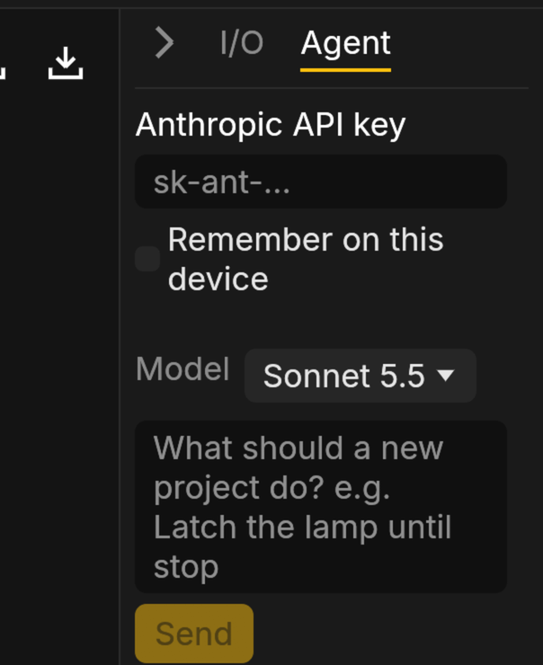
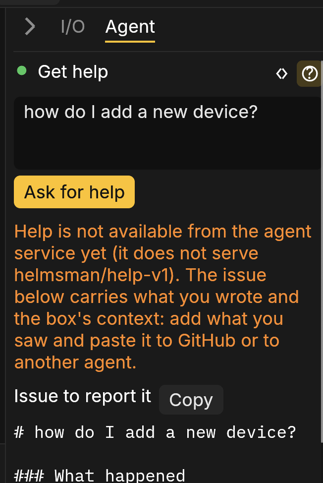

# The Agent

The Agent is the way you program by describing the machine. Open the
**Agent** tab in the side panel (<kbd>Alt</kbd> <kbd>Shift</kbd> <kbd>3</kbd>, then the
tab), type what the open Structured Text file should do, and press
**Send**. The file is updated in place and the editor shows it; there is
no conversation to read through.

An instruction can be a new behaviour ("the lamp latches until stop is
pressed"), a change ("add a two-second delay before the belt starts") or
a fix for the errors under the editor. When the Agent is done, the tab
shows one status line and the Agent's reason for the change, for
example:

> Updated lamp.st: 2 scenarios passed, kept as tests.
> Why: the lamp now latches until stop is pressed.

Nothing runs until you deploy it, as with any edit of your own.

What the change did is marked until your next edit. In the code, lines
it added are on a green ground and a red rule stands where it removed
lines (point at the rule to read them). On the diagram, blocks and wires
it added are outlined green and those it removed are drawn as faint red
ghosts where they were. In the simulation the diagram shows the change
at once; on a box the diagram is what runs, so its marks appear when you
deploy.

## Checked before it is written

With every change the Agent writes one or more scenarios: short
requirement tests, each stating in plain words what it checks, such as
"the lamp stays off while start is not pressed". Before anything is
written, the change is taken into a copy of the project, compiled, and
the scenarios run together with the project's own requirement tests.

If anything fails (a scenario, a requirement test, the compile, or the
whole-file rule below), the Agent is sent what failed and fixes the
answer, up to two more tries. An answer that still fails is never
written: the file stays as it was and the tab says why, one line per
failure. A change that comes without a scenario is asked for one once;
if none comes, it is written and the status line says no scenario checks
it. When the Agent answers without code (it cannot do what was asked, or
it needs one fact from you), the tab shows its words and the file is not
touched.

The scenarios of a change that is written are kept as requirement tests
and appear in the Requirements tab, each under its own words.

When an instruction changes behaviour that an existing requirement test
checks ("the motor runs only while start is held" against a test that
says it latches), the Agent replaces that test with one stating the new
requirement. The replacement has to pass like any scenario, every other
test still has to, and the status line names it:

> Updated main.st: 1 scenario passed, kept as a test; changed requirement
> test_latch: the motor runs while start is held.

The test as it was stays in History, and Undo puts both back.

## History and Undo

Every change the Agent writes is saved as one revision in the project's
History (the Files tab), named after the instruction. Its entry holds the
instruction, the Agent's reason, the scenarios that passed, the answers
that failed and were sent back, and the Agent's words. Edits of your own
you had not saved are saved first, as their own revision, so the version
before the change is always there.

**Undo** in the Agent tab puts the file back as it was before the last
change (a new revision; the change stays in History). It is offered while
the file is still as the Agent left it; after an edit of your own, go
back through History instead.

## Follow-ups

Each instruction goes to the Agent with the whole file and the last five
instructions carried out on that file, read from History. So "now make it
blink faster" works: the Agent knows what "it" is, even after a reload.
To start over, describe the whole behaviour in the instruction.

## What the Agent may change

The Agent edits what you have in focus and nothing else: the file open
in the Code tab, by default. When you select lines in the Code tab or
pick a block in the diagram, a line above the instruction box says so:

- **Editing: lines 12–30 of main.st**: the lines you selected.
- **Editing: block Motor1**: the statement of the block you picked.

**Whole file** next to it drops the selection or the pick. A change to
anything outside the scope (another file, lines outside the selection,
anything beside the block) is refused, and the rest of the project stays
exactly as it was.

The code always comes back as the whole open file with the change made
in it, even for a few selected lines or a block. Nothing may be left
out: an answer that skips part of the file, or writes "rest unchanged"
where code should be, is sent back.

## In the simulation

The playground calls the model from your browser with your own API key.
Paste it in the tab; "Remember on this device" keeps it in this browser
only, and the tab says plainly where the key is kept. Running the
playground from your own machine with a local proxy, or natively with
the key in the environment, the tab says the key is preloaded so you are
not left wondering.

With a built-in example open (they are read-only), the program the Agent
writes becomes a project of its own: the first time, it asks what the
program is called, and later new programs land in the same project as
`main.st`, the one before kept beside it as `v1.st`, `v2.st` and so on.

## On a box

On a box the Agent goes through the box's relay, which holds the key, so
no box and no browser holds it. The tab works the same way: sign in as an
engineer, open a program file, type the instruction and press **Send** or <kbd>Enter</kbd>
(<kbd>Shift</kbd> <kbd>Enter</kbd> or <kbd>Ctrl</kbd> <kbd>Enter</kbd> starts a new line).
The checked change is saved on the box as a revision with its History
entry, by you, and **Undo** asks the box to restore the revision before
it. The dot beside the tab's heading says whether the agent is online
(green), offline (red) or not heard from yet (grey).

If the agent stores a **proposal** for review instead of sending the file
back, the file is not touched and the tab offers **Review** to open it on
the Proposals screen, where an approver signs it off under the box's
policy.

## Get help

On a box the Agent tab has a second mode, for someone who did not write
the program and has a machine that does not do what it should. The
toggle at the top right of the tab switches it: **< >** is **Change the
program**, **?** is **Get help**.

Sign in (any role), say what you saw or what you want to do in your own
words, and press **Ask for help** (<kbd>Enter</kbd> works too;
<kbd>Shift</kbd> <kbd>Enter</kbd> or <kbd>Ctrl</kbd> <kbd>Enter</kbd> starts a
new line). The page sends your words with its recent Messages, and the box
adds what it knows: its version, the program it runs, its devices and
their errors. Passwords, PINs and tokens are left out. Nothing on the box
changes and nothing is filed anywhere.

What comes back depends on what you asked:

- A report of trouble ("the conveyor stopped, the lamp is red") gets
  **What is likely wrong**, the Agent's diagnosis from the box's messages
  and devices, and **Issue to report it**, a Markdown issue that carries
  your words and the box's details. **Copy** takes the whole issue, to
  paste into a new GitHub issue or to give to another agent.
- A question about how things work ("how do I load a program?") gets
  **How to do it**, an answer written from these help pages, with the
  pages it came from linked under **Read more**. No issue is written.

When the agent cannot be reached (the box has no relay, the relay is
offline, or the agent service does not offer help yet), the box writes
the issue by itself from your words and its details, and a line above it
says why there is no diagnosis. For a question it also lists the help
sections whose headings match it, under **These help pages may answer
it**. The picture above shows this case.

**Stop**, shown while the Agent is working, stops waiting for the answer.

## What it will not do

The Agent changes the open file; it never deploys. It cannot force an
input, change the I/O map on a box, or approve anything. Its code is
checked like yours: an error is marked, a deploy that does not compile
is refused.
