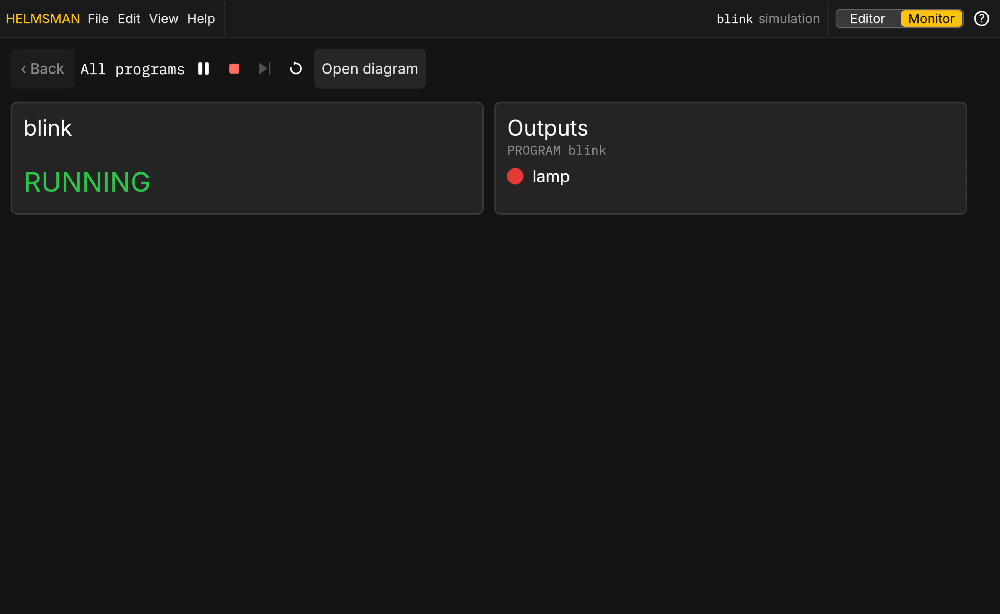

# On a box

A box is a controller on the machine's network. It serves this app
itself: open its address in a browser and the Editor shows what it is
running, with the real inputs and outputs.

## Signing in

Anyone on the network can watch. Editing, saving, deploying and forcing
need an engineer's sign in: **Sign in** in the header, or <kbd>Alt</kbd>
<kbd>F8</kbd>; <kbd>Ctrl</kbd> <kbd>F8</kbd> signs out. A fresh box with
no accounts yet takes a role and its PIN; once an account exists, only
accounts sign in. A session ends when you sign out, when it has been idle
a while, or when it is a day old. Once you are signed in the panel
closes, and the header shows who is signed in with the role's mark: a
hard hat for an operator, a wrench and a screwdriver for an engineer.

## Deploying

Deploy on a box goes through its **approval policy**: a change the policy
calls small lands at once; a larger one, a logic change, is held as a
proposal until an approver signs it off, with a replay in the simulation
to look at first. The header's yellow **waiting** badge counts the
proposals waiting and opens the Proposals screen that lists them.
Nothing runs on the box that was not approved under
the policy, and every change is in the box's audit log.

The first install of a box seeds a project but runs nothing: an engineer
deploys the first program.

## Forcing

Signed in as an engineer, an input's block on the diagram is a control
as in the simulation, but a click **forces** the input: the box holds
the value you set over what the channel reads. A forced input is marked
FORCED in the warning colour on its block and in the I/O panel, a banner
lists every force with a release for each and for all, and forces end
when you sign out or deploy. Forcing is for commissioning and
troubleshooting; the audit log records each one.

From the keyboard: pick the input's block and press <kbd>Ctrl</kbd>
<kbd>Shift</kbd> <kbd>F</kbd> to force it (a BOOL flips, a number's
field opens for the value), and <kbd>Ctrl</kbd> <kbd>Shift</kbd>
<kbd>U</kbd> releases every force. Both are in the Edit menu.

## The trend

The Trend tab opens with the box's own history of each pinned signal,
the last ten minutes, then streams. The window opens on 30 s and widens
to the whole ten minutes. Drag a lane's name up or down to change the
order of the lanes. Pins and their order are yours while you are signed
in and come back on any screen; the box keeps them across a restart
(the history starts over).

## Lost the box

If the box stops answering, the state in the header says so and the last
diagram stays up; the page keeps trying. "Simulate in this browser"
offers to run the program in the page instead. A page that never reached
a box at its address goes to the simulation by itself and says so.

## Your work survives a reload

This browser keeps what you had in front of you: the project and file
you had open, every edit you had not saved yet, what you had typed into
the Agent and Requirements boxes, whether you were on the Monitor, and
the name in the sign-in form (never a password or PIN). Reload the page,
or come back after the box restarts, and it is all where you left it; a
note says when unsaved edits came back. If someone saved the same file
since, saving your edits asks which version to keep instead of
overwriting theirs. Edits still need an engineer signed in to be saved.

## The Monitor

The **Monitor** (the Editor | Monitor toggle, or View › Monitor) is the
watch-only screen for a phone, a tablet or a wall display: one tile per
program with its state and its lamps, green TRUE, red FALSE, and a tap
into each block instance. A phone opens on the Monitor. "Open diagram"
on a tile goes to that level in the Editor. An engineer can turn on
**Scan detail** (View) to see each program's scan period and counts;
they are hidden otherwise.

Signed in as an engineer, the Monitor's header also has **Stop** and
**Restart** for the program on the box: the one shown, or every program
from the top level. Stop holds the program: it stops scanning and its
outputs go to their safe values, and its tile says STOPPED with who
stopped it. The same button then reads **Run** and starts it again where
it left off. Restart starts it again from its initial values. A deploy
leaves a stopped program stopped; a box that restarts starts everything.
The box records each one in its audit log, and anyone not signed in as
an engineer sees neither button. The Editor has the same two buttons
over the diagram, for every program the box runs. On a box no key
stops a program (Ctrl Enter stays the simulation's), so a stray key
never stops a machine.

## HTTPS

A box serves HTTPS with a certificate it made at first boot; the browser
asks once. The certificate's fingerprint is printed at the box's startup
and shown in Help › About, so you can compare the two. From the box's own
host, plain HTTP still works for scripts.
