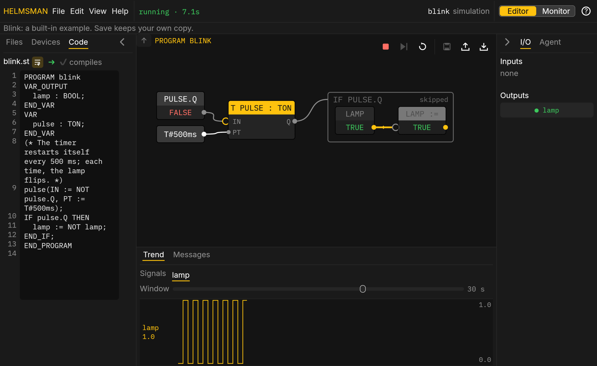

# Getting started

Helmsman is a soft PLC you program by describing the machine. You write a
specification in plain words, the agent writes standard IEC 61131-3
Structured Text from it, you check what it does on a live diagram, and an
engineer approves it before it runs. This is an early release: everything
on these pages is built and in use on the bench; the pages say so where a
part is still to come.

## Try it in your browser

The [playground](../playground/) runs a controller inside the page, with no
install and nothing to sign up for. It opens with a small example running:
a lamp that blinks. The diagram in the middle is the program as it runs,
live; the Structured Text that makes it is one key away (View › Structured
Text, or <kbd>Alt</kbd> <kbd>1</kbd>).

The [guided tour](https://helmsman.advin.io/playground/?tour) walks you
through it in the playground itself: each step points at the control it
is about and moves on when you use it. It takes a few minutes, and Help ›
Take the tour starts it again any time.

Or try these yourself, in order:

1. Watch the lamp on the diagram: Blink's timer flips it every 500 ms.
2. Open **Files** on the left and click **Read and write**. Give it a
   name: it opens as a program of your own, running. Click the `switch`
   block on the diagram; it is an input, the click flips it, and the lamp
   follows.
3. Open the Structured Text and change something. The program keeps
   running what it had; the editor marks any error as you type. Press
   **Deploy** (File › Deploy, <kbd>Ctrl</kbd> <kbd>D</kbd>) to run your
   change.
4. Click an output block, say the lamp. Everything that drives it stays
   lit and the rest dims: that is the diagram's answer to "why".

## The two places it runs

**The simulation** is the playground: the controller runs in the page,
against virtual inputs you flip on the diagram or in the I/O panel. It is
the place to learn, to try a program, and to write one before a box
exists.

**A box** is a real controller on the machine's network. Its page is the
same app served by the box itself; the diagram shows what the box is
running, the inputs and outputs are the real ones, and changes go through
the box's approval policy. Sign in (<kbd>Alt</kbd> <kbd>F8</kbd>) to edit
and deploy. If no box answers at the address, the page runs the
simulation by itself and says so.

## Where things are

- [The Editor](editor.html): the screen, its menus and glyphs, the
  diagram, the panels.
- [The simulation](simulation.html): running, stepping, inputs, the trend.
- [Projects](projects.html): files, save, deploy, upload and download, the
  the examples.
- [On a box](box.html): signing in, deploying through the approval policy,
  forcing, the Monitor.
- [The Agent](agent.html): writing and changing programs from a
  description.
- [Keyboard](keyboard.html) and [Examples](starters.html),
  generated from the program itself.
