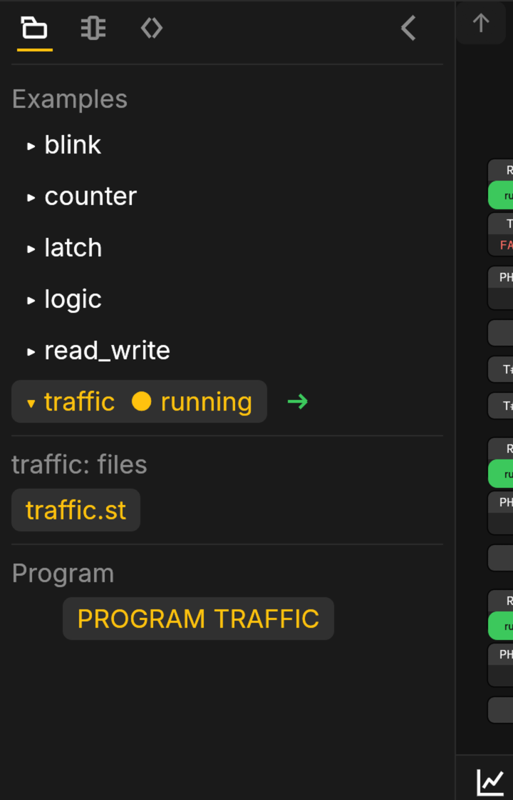

# Projects

A project is a folder of files: the program's Structured Text (one or
more `.st` files, one `PROGRAM`), an `io.map` that says which signal is
which channel, `project.settings`, and two the editor keeps for itself,
`diagram.layout` (a saved arrangement) and `icons.map` (the blocks'
icons, see [The Editor](editor.html)). The Files tab of the left pane
shows them.

## Files

- **New project** and **Copy project** are in the File menu; a right-click
  on the pane's blank space offers New project too, and a right-click on a
  project offers Copy, Rename and Delete. A copy of an example is how
  you begin from one.
- **New file** is the button under the files. A file is Structured Text
  (`.st`), the I/O map, or one of the editor's own. A double click on a
  file opens it on the Code tab.
- **Right-click a file** for Copy, Paste, Duplicate, Rename and Delete.
  Copy keeps the file in the editor's own clipboard, and Paste puts it
  into whichever project is open, under the next free name (`main-2.st`
  after `main.st`), so moving a block between projects is a copy, an
  open, and a paste. Right-click the files heading to paste without a
  file under the pointer.
- **The Delete key** deletes the file or project you clicked last (the
  open project when none). Every delete asks first, in the middle of the
  screen; Escape keeps it. The examples cannot be deleted.
- **earlier (n)** folds the program's earlier iterations, `v1.st`,
  `v2.st`, ... (what `main.st` was before each answer you took from the
  Agent). They are kept with the project and never built; click the row
  to see them, newest first. `main.st` is marked when the project runs.
- **history (n)** folds the project's revisions: every save, upload,
  import and restore, newest first, with who did it, when and what. Click
  one to see it in the middle of the screen: the Agent page it came from,
  if any, and each file's lines added and removed since. A change from
  the Agent says what it changed ("took the Agent's answer into lines
  4–6 of main.st"). **Restore this
  revision** puts the files back as they were (a new revision; an
  engineer's on a box). The box keeps the last two hundred, the
  simulation the last twenty, in this browser.
- The tree under the files is the program: the `PROGRAM`, then each
  function block instance it calls, nested. Click one to see its diagram.



## Save and Deploy

**Save** (<kbd>Ctrl</kbd> <kbd>S</kbd>, File › Save, the glyph) writes
every file with unsaved edits. A mark in the header shows there are some.
Saving changes nothing about what runs.

**Deploy** (<kbd>Ctrl</kbd> <kbd>D</kbd>, File › Deploy, or the → arrow
right of the Structured Text header and beside the running program in
Files) saves first, then compiles the project and runs it: in the page in the simulation, on
the box through its approval policy on a box. A project that does not
compile is refused with its errors by file and line.

On a box, a file someone else saved since you opened it is refused alone
and offers Reload; the other files land.

## Requirement tests

A requirement is worth keeping as a test. A file named `test_NAME.st` is
one: a PROGRAM that drives the program's inputs, lets the clock run and
checks the outputs. Its first comment states the requirement in your
words. The Agent writes one for each change it makes, and a red one names
itself in the Deploy error with which check failed and when.

```st
(* The lamp is on within 2 s of start_pb. *)
PROGRAM test_lamp
VAR_INPUT lamp : BOOL; END_VAR            (* the program's output *)
VAR_OUTPUT start_pb : BOOL; done : BOOL; END_VAR   (* its input; the end *)
VAR t : TON; lamp_on_in_time : ASSERT; (* on within 2 s *) END_VAR
start_pb := TRUE;
t(IN := TRUE, PT := T#2s);
IF t.Q THEN
  lamp_on_in_time(COND := lamp);
  done := TRUE;
END_IF;
END_PROGRAM
```

The test's `VAR_OUTPUT`s drive the program's `VAR_INPUT`s of the same name,
and its `VAR_INPUT`s read the program's `VAR_OUTPUT`s. `ASSERT` latches the
first scan its `COND` is FALSE; `done` ends the test. A test that never
sets `done`, holds no `ASSERT`, or does not compile is red. Test files are
never part of what runs.

The page runs the tests whenever the project's build changes; a box runs
them when a project opens, after each save and before every deploy
(`POST /api/projects/{p}/tests` runs them on demand). **A red test refuses
Deploy and the Agent's "Use this code"**, naming the requirement, so a
change cannot land past a requirement it breaks. The Agent writes the
tests with each change; edit them like any file.

## Upload and download

**Download** (the glyph, File › Download) gives you the project as a
`.zip`. **Upload** takes a `.zip` (a whole project), an `.st` file (into
the open project), a PLCopen `.xml` export, or a ladder export (`.l5x`),
which is converted to Structured Text where the conversion is exact and
refused where it is not, saying why. Each periodic task of a ladder export
keeps its period: the import writes it into `project.settings` as that
program's `scan_ms`, unless you have set one there already.

## Examples

Five short **examples** teach one thing each: Blink, Read and write,
Logic (AND, OR, NOT), a start/stop latch and a counter. Click one and
give it a name: it becomes a program of your own to change. On a box the
same list makes the program on the box, its inputs and outputs on the
box's own channels so it runs with nothing wired.

[Examples](starters.html) lists them, generated from the
program itself.

## The I/O map

`io.map` binds the program's inputs and outputs to channels: a line per
signal with its direction, name, type, the device and the channel, and
for an output its safe value. The examples' maps use the box's own
channels and say in a comment to check them before deploying to a box
with anything wired.
