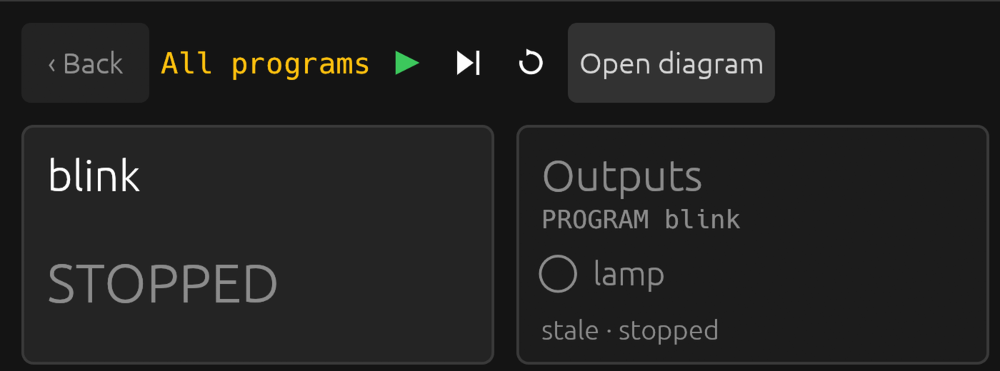
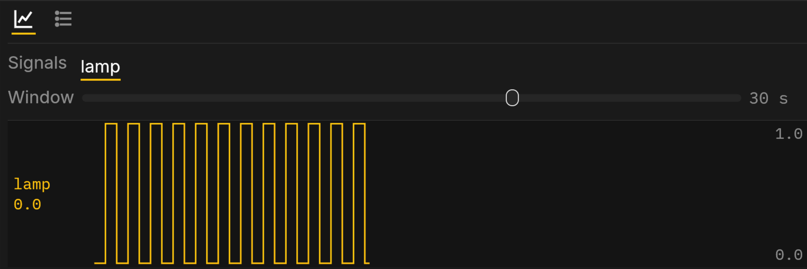

# The simulation

The simulation runs the controller inside the page, scan by scan, against
inputs you set yourself. It is what the playground is, and what a box's
page falls back to when no box answers.

New to it? The [guided tour](https://helmsman.advin.io/playground/?tour)
copies the Blink example, changes it, deploys it and reads its trend,
with each step pointing at the control it is about.

## Running

A project opens running. The glyphs over the diagram run or stop it
(<kbd>Ctrl</kbd> <kbd>Enter</kbd>; <kbd>Shift</kbd> <kbd>F8</kbd> stops),
step one scan while stopped (<kbd>F10</kbd>), and restart from initial
values with the clock at zero. The same three buttons and keys are in
the Monitor's header. The state in the header says which it is; the
clock beside it is the program's own time.

One program runs in the page at a time. Opening or deploying another
stops the one before.

## Breakpoints

Pick a block in the diagram and press <kbd>Ctrl</kbd> <kbd>B</kbd> (or
**Edit › Breakpoint**): a red dot marks it. The next scan that reaches
the block stops just before it runs, the simulation stops with it, and
the diagram and every value show the scan as it stood at that moment.
The block is framed in orange and the notice under the header names its
line. <kbd>F10</kbd> runs the rest of that scan.
<kbd>Ctrl</kbd> <kbd>Enter</kbd> goes on to the next stop: the same
block's next pass in a loop, another breakpoint, or the next scan. An
input you change while stopped shows at once in what the diagram shows.
A breakpoint inside a function block stops in every instance of it.
<kbd>Ctrl</kbd> <kbd>B</kbd> on the block again clears it. Stopping at a
breakpoint changes nothing the program does: the scan runs exactly as it
would have.

## Editing

Type in the Structured Text pane. The editor checks what you typed after
a short pause and marks any error on its line; the diagram and the
program running stay as they were. **Deploy** (<kbd>Ctrl</kbd>
<kbd>D</kbd>) compiles your text and runs it, if it compiles. If it does
not, the errors are listed under the editor, a click on one goes there,
and the last good program keeps running.

Undo and Redo (<kbd>Ctrl</kbd> <kbd>Z</kbd>, <kbd>Ctrl</kbd> <kbd>Y</kbd>)
work in the editor and from the Edit menu.

<kbd>Ctrl</kbd> <kbd>F</kbd> opens a find box over the Structured Text.
Every match is marked in yellow, the current one brighter, and the pane
scrolls to it; the box counts them. <kbd>Enter</kbd> or
<kbd>Ctrl</kbd> <kbd>G</kbd> goes to the next match,
<kbd>Shift</kbd> <kbd>Enter</kbd> or <kbd>Ctrl</kbd> <kbd>Shift</kbd>
<kbd>G</kbd> to the previous one, and letters match in either case, as
Structured Text does. <kbd>Esc</kbd> closes the box and leaves the match
selected in the editor. It works the same on a box's code.

## Inputs

Every input of the program has a control: on the diagram, where the
program reads it, or in the I/O panel for the ones the diagram does not
show.

- A BOOL input the program reads once in a while is a **switch**: click
  to flip. It shows TRUE in green, FALSE in red.
- A BOOL input the program reads as a button (`start_pb`, `stop_pb`,
  `ack_pb`) is a **push button**: on while you hold it.
- A number takes what you type; <kbd>Enter</kbd> or leaving the field
  commits it, <kbd>Esc</kbd> puts the old value back. The I/O panel's
  sliders apply as you drag.

With an input's block picked, <kbd>Ctrl</kbd> <kbd>Shift</kbd>
<kbd>F</kbd> flips a switch or opens a number's field, so you can set
inputs without the mouse.

A project can carry a plant model, a block that stands in for the tank,
the belt or the compressors, so that it moves with nothing wired.

## The trend

The Trend tab along the bottom plots the signals you pin, up to six,
each in its own lane with its last value. The Window slider sets how
much of the past the pane shows, from 100 ms to 10 minutes on a
logarithmic scale (it opens on 30 s), and the plot follows as you drag;
history is kept for the widest, so widening shows what already ran. The
lane's scale is at its right edge: it rounds out to an even step and
moves only when the values cross one. Pin from the tab's list. History
restarts when you change the set. To put the lanes in another order,
drag a lane's name up or down and drop it on the lane it should take;
its history moves with it.

## Faults

A program that divides by zero, runs past its watchdog, or writes an
output out of range **faults**: it stops at the statement that did it,
outputs go to their safe values, the state reads `faulted` in red and
the Messages tab records what happened. Run or Step restarts it.
